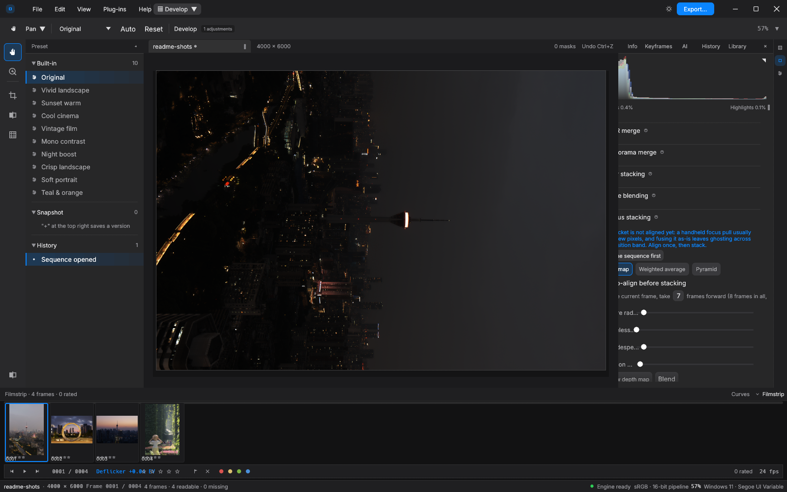
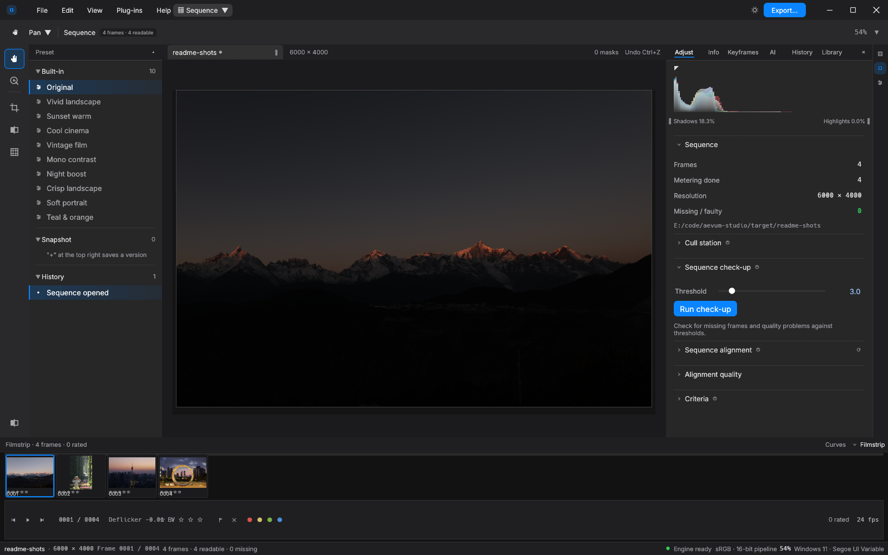
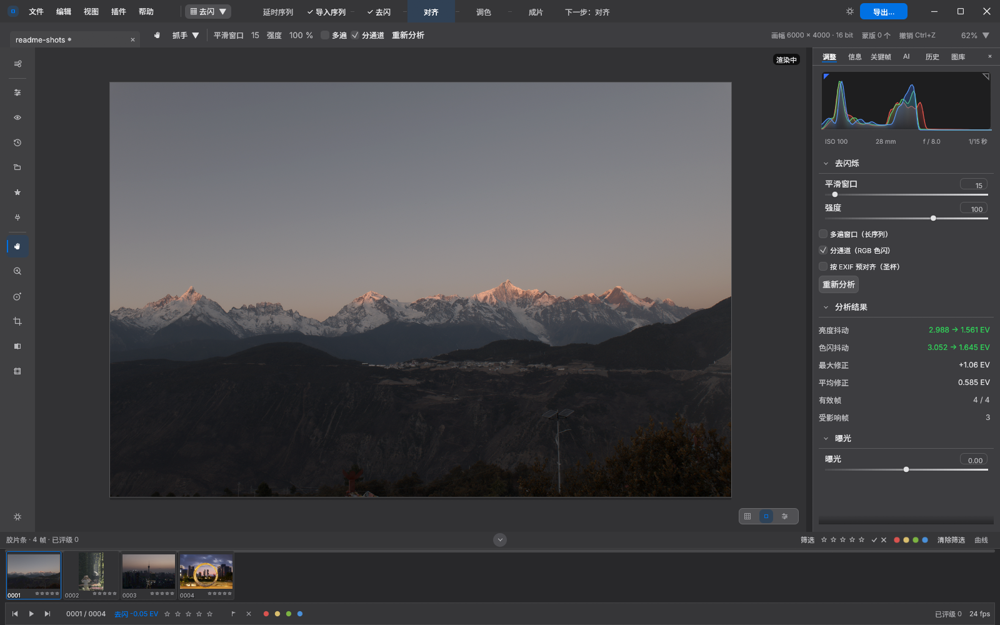
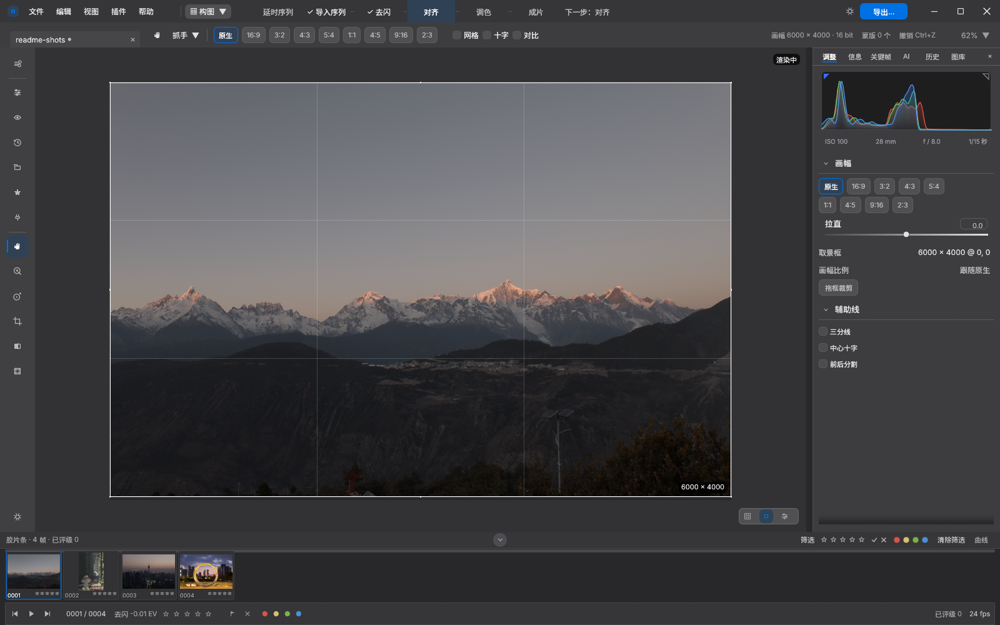
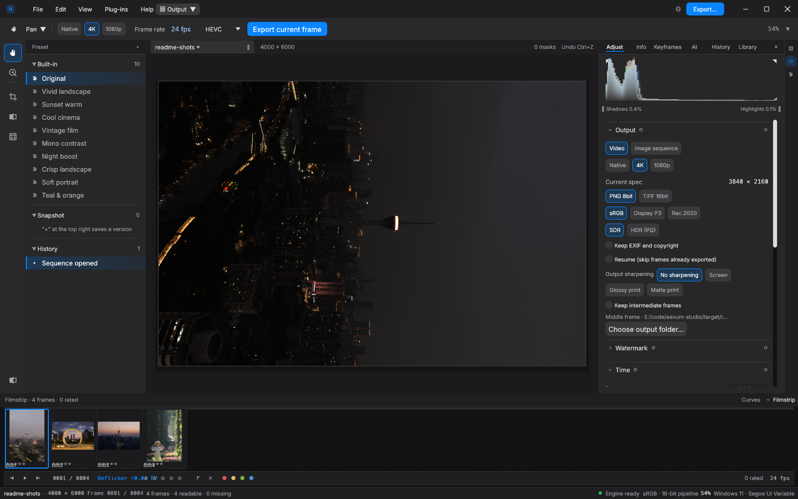

# Aevum Studio · 恒晷

[中文](README.md) · **English**

**Aevum Studio** (Chinese name: 恒晷) is a desktop photo-finishing / timelapse tool
written in Rust. It takes you from a sequence of camera frames to a finished film in one
window: **align → composite → crop (with camera motion) → color grade → music → motion
(speed ramps & motion blur)**. Each step feeds the next automatically; drop a file or
folder onto the window and it switches to the right module.

> **Current version**: `1.9.0`: core features work and are pinned by numeric golden
> tests, and the four compatibility promises under "Versioning" (project format / presets and
> parameters / command line / MCP tools) take effect from this release. Per-version changes and
> known limitations live in `docs/发布说明-v1.0.0.en.md` and `CHANGELOG.en.md`.
>
> As of `0.5.0` the product was renamed from "Lumen Studio" to "Aevum Studio".
> Old projects (`.lumen/`), old `LUMEN_*` environment variables and old `lumen_*` MCP
> tool names keep working — see "Upgrading from 0.4 and earlier" below.

## A look at the interface

One window carries the whole pipeline. Develop is the main workspace — presets and
history on the left, canvas and masks in the middle, parameters and histogram on the
right, a per-frame filmstrip along the bottom. From 1.5 focus stacking lives here too,
with the depth map / weighted average / pyramid methods side by side and optional
auto-alignment before fusing:



| **Sequence — alignment check-up** | **Deflicker — per-frame metering curves** |
|---|---|
|  |  |
| **Compose — crop and straighten** | **Render — export and the render queue** |
|  |  |

## Why this project exists

Producing a decent timelapse today means moving files across four or five tools:
LRTimelapse for deflicker, Lightroom for grading, After Effects or Premiere for the
final render — with repeated exports and imports in between. Each tool owns one
segment of the process, so:

- **parameters don't carry over**: a grade tuned in Lightroom can only be approximated
  with LUTs once it reaches the compositing tool;
- **the preview and the final film disagree**: every tool sees only its own segment,
  and no tool is responsible for the finished picture;
- **one missed step restarts everything**: a forgotten XMP save is enough to ruin an
  overnight render.

Aevum's goal is to fit "camera sequence → finished film" into **one window**: import,
alignment, deflicker, develop, compose, soundtrack and export form a single pipeline
where each step's output flows into the next and parameters follow the sequence all
the way through. For single-photo editors this is a side quest; for Aevum it is the
whole point.

## Features

- **Sequence pipeline**: frame alignment (sub-pixel), deflicker (luminance-curve based,
  with optional EXIF pre-alignment so a day-to-night transition is not eaten),
  HDR merge, panorama stitching, multi-frame fusing (star stacking / time blending / focus
  stacking)
- **Develop / grading**: a tone pipeline aligned with classic Lightroom behavior
  (exposure / curves / HSL / split tone / sharpening / denoise / grain / dark-channel dehaze),
  masks (linear / radial / brush) with local adjustments
- **Output**: stills & video export, render queue, exact output size, watermark,
  retime with motion blur (frames are piped straight into ffmpeg's stdin — no temporary frame files);
  platform delivery presets (Douyin / WeChat Channels / Xiaohongshu / Bilibili / master:
  frame, rate, encoder and quality in one click, from an editable table — no rebuild to retune);
  HDR stills go out as AVIF 10bit + PQ (203-nit reference white, BT.2020, full range)
- **AI Agent control plane**: a built-in MCP stdio server (43 `aevum_*` tools), plus a
  loopback HTTP proxy that forwards headless MCP calls to a running GUI (attach mode,
  exposing all 77 GUI commands with live UI updates)
- **Numeric goldens**: the Python reference (`acceptance/reference/grade.py`) mirrors the Rust pipeline
  formula-by-formula; 47 develop golden cases plus cube/grade suites pin bit-level agreement

- **Bilingual UI**: Chinese / English switchable at runtime (pick it in the look panel;
  "follow system" is the default and the preference lives in `settings.json`, never in a
  project). Coverage is guarded by `tests/i18n_coverage.rs`: the whole UI is painted in
  English and every rendered glyph is scanned — one Chinese character on screen fails the test

## Where it stands against Lightroom / Photoshop

Lightroom and Photoshop are the industry standard for editing single photographs, and
Aevum's develop chain deliberately follows Lightroom's classic conventions
(exposure / curves / HSL / split toning / sharpening ...); `crs:` parameter keys in XMP
presets are read directly. The difference is the *sequence*:

| | Lightroom / Photoshop | Aevum Studio |
|---|---|---|
| basic unit | a single photo | the sequence (sequences are first-class citizens) |
| timelapse deflicker | none built in; needs LRTimelapse | built in: per-frame metering curves + luminance correction; EXIF pre-alignment keeps a holy-grail transition |
| frame alignment | none | sub-pixel translation alignment + an alignment check-up |
| HDR / stacking | manual, script-driven stacking in PS | multi-frame merge feeds straight into the develop chain |
| video output | LRT → LR → AE/PR, three hops | direct mp4 export (H.264 / H.265 10-bit HDR), batch render queue |
| grading parameters | XMP presets | the same XMP (`crs:` keys) + keyframes inside the project |
| automation | — | a built-in MCP control plane: 43 tools an AI agent can drive directly |
| licence | subscription | MIT, free and open source |

One sentence: **single-photo retouching remains Lightroom / Photoshop territory;
getting from a sequence of photos to a finished film takes one window in Aevum.**

## Repository layout

```
crates/aevum-core/   Algorithms: sequence / metrics / deflicker / grade / preview / align / export / interp / project / xmp / journal
crates/aevum-ui/     egui 0.37 UI: state / shell (14 submodules) / theme / widgets / controls
crates/aevum-mcp/    Agent control plane: MCP tools, stdio JSON-RPC, GUI loopback proxy
apps/aevum-studio/   Entry point (--open / --demo / --shot / --module / --selftest / --mcp)
acceptance/          Acceptance kit: check.sh (commit gate) · subdirs reference/ (Python reference) and oracle/ (frozen goldens)
tools/               Audit & dev helper scripts
scripts/             package.sh (portable build) · shots.sh (UI screenshots) · migrate-to-aevum.sh (legacy migration)
.github/workflows/   ci.yml — runs the same acceptance/check.sh on CI
```

> `acceptance/` is the **acceptance kit**, not product code: `acceptance/reference/` is the
> Python implementation that mirrors the Rust pipeline formula-by-formula,
> `acceptance/oracle/golden/` is the numeric goldens it freezes, and `check.sh` is the commit
> gate. The product is pure Rust and the exe ships no Python — this directory is not part of
> `cargo build` and is never packaged. See `acceptance/README.en.md`.

(Design docs and review records are written to the local `docs/` and are **not shipped with
the repository**; the only tracked files there are the public commitments — the per-version
release notes and `docs/1.0.0-验收清单.md`. Everything else is ignored by `.gitignore`.
Per-version notes and downloads are on GitHub Releases.)

## Build & run

Requirements: Rust 1.89+ (MSRV); ffmpeg optional (video export; lookup order
`AEVUM_FFMPEG` → next to the exe → `tools/` → `PATH`).

```bash
cargo build --release -p aevum-studio
target/release/aevum.exe --demo
```

| Command | Purpose |
|---|---|
| `aevum.exe` | Normal GUI; also starts a control service on a random `127.0.0.1` port |
| `aevum.exe --open <frame-dir>` | Open a sequence |
| `aevum.exe --mcp` | Headless MCP stdio server (no window) |
| `aevum.exe --mcp --attach <control.json>` | Proxy MCP calls to a running GUI |
| `aevum.exe --selftest` | Headless self-check (per-module layout shape counts) |
| `aevum.exe --shot <png> --module <module>` | Self-screenshot then exit (visual regression) |

## Upgrading from 0.4 and earlier

The rename does not touch your data or configuration; old state is migrated when opened:

- **Project directory**: `<sequence>/.lumen/` and the older `<sequence>/.lapse/` are moved
  to `<sequence>/.aevum/` when the sequence is opened. Old directories are never deleted;
  if the new one already exists, `.aevum` wins.
- **Environment variables**: `AEVUM_*` takes precedence and falls back to `LUMEN_*`
  when unset (a one-line notice is printed to stderr on first use).
- **Config directory**: `%APPDATA%/lumen-studio` (and the older `lapse-studio`) is merged
  into `%APPDATA%/aevum-studio` on first launch; the old directory is kept. Setting any of
  `AEVUM_SETTINGS` / `AEVUM_LIBRARY` / `AEVUM_RENDER_QUEUE` / `AEVUM_PLUGINS` disables the
  merge entirely (portable mode).
- **MCP tool names**: the canonical names are now `aevum_*`; old `lumen_*` names still work
  as silent aliases, but `tools/list` only advertises the new names.
  **Please refresh `tools/list` in your client after upgrading.**

To convert a whole library at once use `scripts/migrate-to-aevum.sh <dir>`
(dry-run by default; pass `--apply` to actually move).

## Upgrading from 0.5 beta

Install over the top: unzip the new build over the old folder — there is nothing to migrate.
Projects (`<sequence>/.aevum/`) and configuration (`%APPDATA%/aevum-studio`) stay where they
are, existing projects open as before, and parameters, ratings, flags, keyframes and camera
moves are untouched. What 1.0 does and does not promise is spelled out under "Versioning" below.

## Testing

```bash
bash acceptance/check.sh        # commit gate: version check / fmt / clippy / tests / selftest
cargo test --workspace          # full suite, incl. 47 develop golden cases
cargo clippy --workspace        # lint gate
```

Golden workflow: when touching a Rust numeric path, mirror the change in
`acceptance/reference/grade.py` formula-by-formula, then re-freeze with
`./.venv/Scripts/python.exe acceptance/oracle/freeze_golden.py --develop-only`;
two consecutive freezes must be byte-identical.

## Versioning

`Cargo.toml` is the single source of truth for the version; the current release is
`1.9.0`. That is the first stable release; from here every fix or feature bump gets a tag,
and there is nothing to migrate from the `0.x` tags.

**Compatibility promises start with `1.0.0`** and hold for the whole 1.x series — the
beta-stage "no cross-version promises" ends there. Four contracts, each maintained under the
terms below; changing any of them waits for the next major version:

1. **Project file format** (`<sequence>/.aevum/project.json`): within 1.x we only *add* fields,
   always with `serde(default)`; no field is removed and no existing field changes meaning. All
   three directions hold — old projects open in new builds (missing fields take defaults); a
   project written by a new build opens in an old build with only the unknown new fields
   dropped, with no error and no refusal to open; and opening the same project in any two 1.x
   builds never loses existing parameters.
2. **Presets and persisted parameters**: exactly the same terms as the project format. Presets
   and projects share one parameter struct (`GradeParams` — JSON fields in the project, `crs:`
   keys in an XMP preset), and keyframes, grade copies and `settings.json` are covered too.
   Within 1.x we only add fields/keys, absent means default, nothing is removed or redefined;
   a preset or settings file written by a new build loses only the added parts in an old build.
3. **Command-line arguments**: existing flags and their meaning do not change within 1.x; new
   flags are additive only and never alter the behaviour of existing ones; a deprecated flag
   keeps working, prints a one-line notice to stderr on first use (naming the replacement), and
   is removed in the **next major version**.
4. **MCP tool set**: no breaking change to tool names within 1.x; new tools are appended, and
   the name, input schema and result shape of existing tools stay as they are. The legacy-name
   fallback for `tools/list` is unchanged: old `lumen_*` names still work as silent aliases
   while the list advertises only `aevum_*` (see "Upgrading from 0.4 and earlier").

**License**: MIT (see the `LICENSE` file). Third-party components shipped with the binary are
covered by `THIRD-PARTY-NOTICES.txt` and `licenses/`: `rawler` is **LGPL-2.1** and is
statically linked into `aevum.exe`; for a binary with no copyleft code at all, build with
`cargo build --release --no-default-features` (RAW falls back to the built-in backend,
behaviour identical to v0.3.0)
