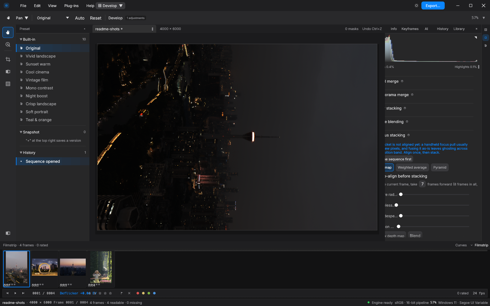
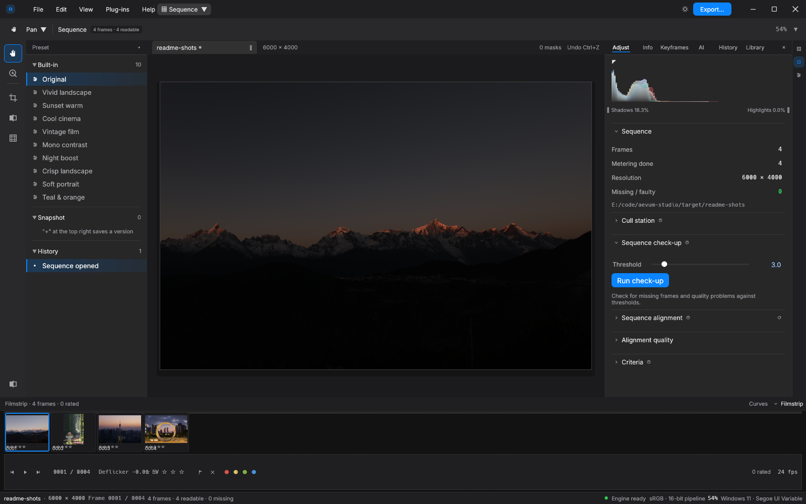
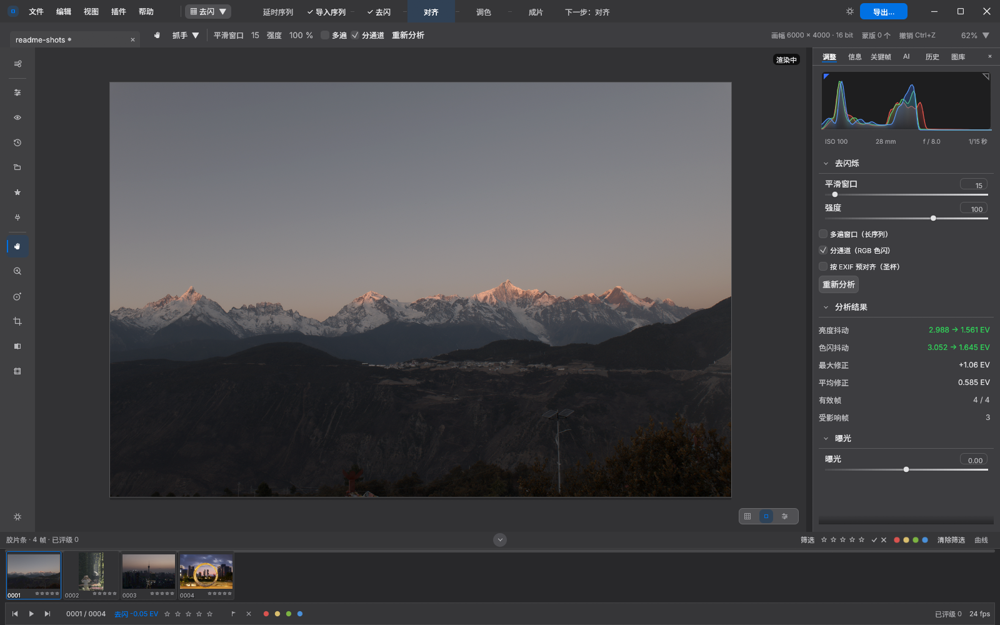
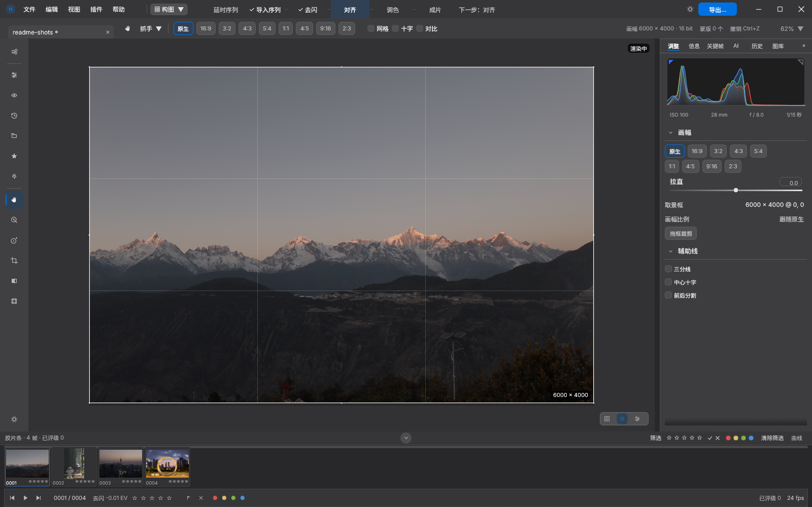
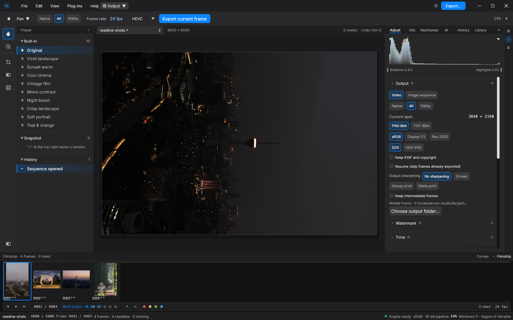

# 恒晷 · Aevum Studio

**中文** · [English](README.en.md)

**恒晷（Aevum Studio）** 是一款用 Rust 编写的桌面修图 / 延时摄影软件：从相机序列照片出发，
一步接一步做到成片 —— 对齐 → 合成 → 裁剪（含运镜）→ 调色 → 配乐 → 运动（变速与运动模糊），
全部在同一个窗口里完成。上一步的产物自动流进下一步；把文件或文件夹拖进窗口，
会直接切到该去的模块。

> **当前版本**：`1.9.1`——核心功能可用并带数值金标回归，从本版起执行下面
> 「版本方案」里的四类兼容承诺（工程格式 / 预设与参数 / 命令行 / MCP 工具集）。
> 逐版改动与已知限制见 `docs/发布说明-v1.0.0.md` 与 `CHANGELOG.md`。
>
> `0.5.0` 起产品由「光时 / Lumen Studio」更名为「恒晷 / Aevum Studio」。
> 旧工程的 `.lumen/` 护带目录、旧环境变量 `LUMEN_*`、旧 MCP 工具名 `lumen_*`
> 都仍然可用（见下面的「从旧版本升级」）。

## 界面一览

一个窗口装着整条流水线。显影是主战场——左侧预设与历史，中央画布与蒙版，
右侧参数与直方图，底部胶片条逐帧导航；1.5 起焦点合成也在这里，深度图 /
加权平均 / 金字塔三个方法并排，合成前可选自动对齐：



| **序列 —— 对齐质量体检** | **去闪 —— 逐帧测光与亮度曲线** |
|---|---|
|  |  |
| **构图 —— 裁剪与拉直** | **成片 —— 导出与渲染队列** |
|  |  |

## 为什么做这个项目

做一条像样的延时视频，今天要在四五个软件之间搬运文件：LRTimelapse 去闪、
Lightroom 调色、After Effects / Premiere 合成，中间反复导出导入。每个软件只负责
一段流程，于是——

- **参数不能复用**：在 Lightroom 里调好的影调，到合成软件里只能靠 LUT 近似；
- **预览与成片不一致**：每个软件只看到自己那一段，谁也不为最终画面负责；
- **漏一步就重来**：「XMP 忘了保存」这样的小事足以毁掉一次整夜渲染。

恒晷的目标是把「相机序列照片 → 成片」收进**一个窗口**：导入、对齐、去闪、显影、
构图、配乐、导出是一条流水线，上一步的产物自动流进下一步，参数全程跟随序列。
这件事对单张修图软件来说是「顺便」，对恒晷是「本业」。

## 功能特性

- **序列处理管线**：帧对齐（亚像素平移）、去闪（亮度曲线校正；可按 EXIF 曝光三要素
  预对齐，日转夜不被去闪吃掉）、HDR 合并、全景拼接、多帧合成（星空堆栈 / 时间合成 / 焦点合成）
- **显影 / 调色**：对齐 Lightroom 经典口径的影调链（曝光 / 曲线 / HSL / 分离色调 / 锐化 / 降噪 / 颗粒 / 暗通道去雾），
  蒙版（线性 / 径向 / 画笔）与局部调整
- **成片**：静帧与视频导出、渲染队列、精确输出尺寸、水印、变速与运动模糊（ffmpeg 管线直推，不留临时帧）；
  平台交付预设（抖音 / 视频号 / 小红书 / B 站 / 母版的口径，一次填好画幅、帧率、编码与质量档，
  表可编辑、改表不用改代码）；HDR 静帧走 AVIF 10bit + PQ（参考白 203 nits，BT.2020，full range）
- **AI Agent 控制面**：内置 MCP stdio server（直连 43 个 `aevum_*` 工具），也可通过本地回环 HTTP
  把 MCP 调用代理给已打开的 GUI（附着模式，暴露 GUI 的全部 77 条命令，界面实时更新）
- **数值金标**：Python 参考实现（`acceptance/reference/grade.py`）与 Rust 逐式同构，
  47 个显影金标 case + cube/grade 等多套金标钉住像素级一致

- **界面双语**：中文 / English 运行时切换（外观面板里选，跟随系统为默认，偏好存
  `settings.json` 不随工程走）。界面文案的完整性由 `tests/i18n_coverage.rs` 守门：
  把整个界面用英文画一遍、扫渲染结果里的每一个字，上屏汉字即测试红

## 与 Lightroom / Photoshop 的关系

Lightroom 和 Photoshop 是单张照片修图的行业标准，恒晷的显影链也正是参照
Lightroom 的经典口径实现的（曝光 / 曲线 / HSL / 分离色调 / 锐化……），XMP 预设里的
`crs:` 参数键可以直接读进来。差别在「序列」：

| | Lightroom / Photoshop | 恒晷 Aevum Studio |
|---|---|---|
| 基本单元 | 单张照片 | 序列（以序列为一等公民） |
| 延时去闪 | 无内置，需 LRTimelapse 配合 | 内置：逐帧测光曲线 + 亮度曲线校正；圣杯可用 EXIF 预对齐（相机补偿剥掉、日夜过渡保留） |
| 帧间对齐 | 无 | 亚像素平移对齐 + 对齐质量体检 |
| HDR / 堆栈 | PS 脚本手动堆栈 | 多帧合并直接进显影链 |
| 出视频 | LRT → LR → AE/PR，三段三跳 | 直接导出 mp4（H.264 / H.265 10bit HDR），支持队列批量 |
| 调色参数 | XMP 预设 | 同一套 XMP（`crs:` 键）+ 工程内关键帧 |
| 自动化 | — | 内置 MCP 控制面，43 个工具可被 AI Agent 直接驱动 |
| 许可 | 订阅制 | MIT 开源，免费 |

一句话：**单张精修仍是 Lightroom / Photoshop 的主场；从序列照片到成片这件事，
恒晷一个窗口走完。**

## 仓库结构

```
crates/aevum-core/   算法核心：sequence / metrics / deflicker / grade / preview / align / export / interp / project / xmp / journal
crates/aevum-ui/     egui 0.37 界面：state / shell（14 个子模块）/ theme / widgets / controls
crates/aevum-mcp/    Agent 控制面：MCP 工具、stdio JSON-RPC 与 GUI 回环代理
apps/aevum-studio/   入口（--open / --demo / --shot / --module / --selftest / --mcp）
acceptance/          验收仪器：check.sh（提交门槛）· 子目录 reference/（Python 参考实现）与 oracle/（冻结金标）
tools/               审计与开发辅助脚本
scripts/             package.sh（绿色包）· shots.sh（界面截图）· migrate-to-aevum.sh（旧工程迁移）
.github/workflows/   ci.yml —— CI 上跑同一个 acceptance/check.sh
```

> `acceptance/` 是**验收仪器**，不是产品代码：`acceptance/reference/` 是与 Rust 实现逐式同构的
> Python 参考实现，`acceptance/oracle/golden/` 是它冻结出来的数值金标，`check.sh` 是提交门槛。
> 产品是纯 Rust，exe 里不含任何 Python——这个目录既不参与 `cargo build`，也不随包分发。
> 改算法时它跟着逐式改（见「测试」），详见 `acceptance/README.md`。

（设计文档与评审记录写在本地 `docs/`，**不随仓库分发**；入库的只有对外承诺的几份——
各版本发布说明与 `docs/1.0.0-验收清单.md`，其余是 `.gitignore` 掉的过程文档。
逐版说明与下载见 GitHub Releases。）

## 构建与运行

要求：Rust 1.89+（MSRV）、ffmpeg（可选，导出视频用；查找顺序 `AEVUM_FFMPEG` → exe 同目录 → `tools/` → `PATH`）。

```bash
cargo build --release -p aevum-studio
target/release/aevum.exe --demo
```

| 命令 | 用途 |
|---|---|
| `aevum.exe` | 正常 GUI；同时在 `127.0.0.1` 随机端口开控制服务 |
| `aevum.exe --open <帧目录>` | 打开序列 |
| `aevum.exe --mcp` | 无头 MCP stdio server，不开窗口 |
| `aevum.exe --mcp --attach <control.json>` | 把 MCP 调用代理给已开的 GUI |
| `aevum.exe --selftest` | 无显示器自检（各模块布局形状计数） |
| `aevum.exe --shot <png> --module <模块>` | 程序自己截图后退出（供视觉回归） |

## 从旧版本升级（0.4 及更早）

改名不影响已有的数据和配置，打开旧工程时会自动迁移：

- **工程目录**：`<序列>/.lumen/` 与更早的 `<序列>/.lapse/` 会在打开序列时搬成 `<序列>/.aevum/`。
  旧目录不删；若目标已存在则以 `.aevum` 为准。
- **环境变量**：`AEVUM_*` 优先，未设置时回退读 `LUMEN_*`（首启会在 stderr 提示一行）。
- **配置目录**：`%APPDATA%/lumen-studio`（及更早的 `lapse-studio`）首次启动时并进
  `%APPDATA%/aevum-studio`，旧目录保留。设了 `AEVUM_SETTINGS` / `AEVUM_LIBRARY` /
  `AEVUM_RENDER_QUEUE` / `AEVUM_PLUGINS` 等便携变量时不碰 `%APPDATA%`。
- **MCP 工具名**：规范名已是 `aevum_*`；旧名 `lumen_*` 作为静默别名继续可用，
  但 `tools/list` 只列新名。**升级后请在客户端重新拉取一次 `tools/list`。**

一次搬完整个素材盘可以用 `scripts/migrate-to-aevum.sh <目录>`（缺省只预览，加 `--apply` 才动手）。

## 从 0.5 beta 升级

覆盖安装即可：解压新包、替换旧包目录，没有任何迁移步骤。工程目录（`<序列>/.aevum/`）与
配置目录（`%APPDATA%/aevum-studio`）都不动，旧工程直接打开，参数、评级、标记、关键帧、
运镜照旧。1.0 之后能承诺什么见下面「版本方案」的四类兼容承诺。

## 测试

```bash
bash acceptance/check.sh        # 提交门槛：版本一致性 / fmt / clippy / 全量测试 / 界面自检
cargo test --workspace          # 全量测试（含 47 个显影金标 case）
cargo clippy --workspace        # lint 门禁
```

金标机制：改 Rust 数值路径时，同步修改 `acceptance/reference/grade.py`（逐式镜像），再运行
`./.venv/Scripts/python.exe acceptance/oracle/freeze_golden.py --develop-only` 重冻结；
连续两遍冻结必须逐字节一致。改完算法客观判定只看 `bash acceptance/check.sh` 是否全绿。

## 版本方案

版本号以 `Cargo.toml` 为唯一真源，当前为 `1.9.1`。`1.0.0` 是第一个正式版，此后每次修复或
功能推进打一个 tag；`0.x` 阶段（`0.5.0-beta.2` 及更早）每轮功能/重构打 tag，与本版之间
没有迁移步骤。

**`1.0.0` 起进入 1.x 兼容承诺期**——beta 阶段的「不承诺跨版本兼容」到此为止。四类对外契约
按下面的口径维护，任何一条要改都留到下一个主版本：

1. **工程文件格式**（`<序列>/.aevum/project.json`）：1.x 内**只增字段**，新增字段一律带
   `serde(default)`，不删字段、不改已有字段的语义。三个方向同时成立——旧工程能被新版本打开
   （缺的字段取默认值）；新版本写出的工程被旧版本打开时**只丢掉它不认识的新字段**，不报错、
   不拒绝打开；同一份工程在任意两个 1.x 版本之间来回打开不会丢已有参数。
2. **预设 / 参数持久化**：口径与工程格式完全相同。预设与工程共用同一份参数结构
   （`GradeParams`：工程里是 JSON 字段，XMP 预设里是 `crs:` 键），工程内的关键帧、调色副本
   与应用设置 `settings.json` 一并适用——1.x 内只增字段/只增键，缺省即默认值，不删不改语义；
   新版本写的预设或设置，在旧版本里只丢新增的那部分。
3. **命令行参数**：已有参数及其语义在 1.x 内不变；新增参数只追加，不改已有参数的行为；
   弃用先保留——首次使用时在 stderr 打一行提示（带上替代写法）——到**下一个主版本**才移除。
4. **MCP 工具集**：工具名在 1.x 内不做破坏性变更；新增工具只追加，已有工具的名字、入参与
   返回结构不改。`tools/list` 的旧名回退策略照旧：旧名 `lumen_*` 作为静默别名继续可调，
   列表只列 `aevum_*`（见上面「从旧版本升级」）。

**许可**：MIT（见 `LICENSE` 文件）。随二进制分发的第三方组件的许可与义务见
`THIRD-PARTY-NOTICES.txt` 与 `licenses/`：其中 rawler 为 **LGPL-2.1** 且静态链接进
`aevum.exe`，需要完全不含 copyleft 的构建时用 `cargo build --release --no-default-features`
（RAW 走内置后端，行为与 v0.3.0 一致）
